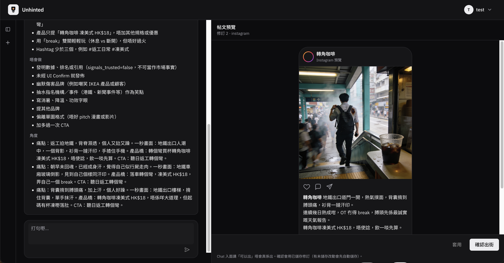

# Unhinted Marketing Agent

[**unhinted.hk**](https://unhinted.hk) · [**Live Demo**](https://demo.unhinted.hk) · [**Docs**](docs/GETTING_STARTED.md)

AI marketing assistant for the Hong Kong market — background signal ingestion plus user-guided content preview and publish. The LLM owns the recommend/draft loop only; publishing is a traditional Confirm → HTTP flow.

> **你有生意要忙，唔使日日由零諗出咩。**  
> Unhinted 幫你由香港熱話搵切入點，結合產品賣點，寫成地道廣東話社交內容。你揀方向、改稿，確認先發佈。



## Why Unhinted?

- **HK-Native Voice**: Local Cantonese phrasing tailored to your brand tone — from corporate safe to sarcastic (港式抽水).
- **Trend-to-Post Ingestion**: Matches real-time Hong Kong market signals (news, Google Trends, social feeds) with your catalog.
- **Confirm ≠ Chat ([ADR 0003](docs/adr/0003-confirm-without-llm.md))**: Zero risk of AI hallucinations publishing directly. Saying "可以出" in chat will never publish; only an explicit user click on the Confirm button triggers the HTTP publish endpoint.
- **Self-Hosted & Private**: Single-command Docker deployment with PostgreSQL (pgvector). Your product catalog, brand settings, and credentials stay in your own infrastructure.

## How it works

1. **Signal Ingestion**: Monitors Hong Kong market trends and pairs relevant talking points with your products.
2. **Angle Picking**: Presents multiple editorial directions before drafting — you stay in control of the angle.
3. **Interactive Workspace**: Co-pilot copywriting and visual plans with real-time Instagram layout preview.
4. **Human-in-the-Loop Confirmation**: Posts are only published when you review and click Confirm.

## Self-host (Docker)

Two Compose packages — [full ops guide](deploy/README.md):

**All-in-one** — bundled pgvector Postgres, single box:

```bash
curl -LO https://github.com/brandon-wsc/unhinted-marketing/releases/latest/download/compose.yaml
docker compose -f compose.yaml up -d   # → http://localhost:8484, first-run /setup wizard
```

**External DB** — bring your own Postgres (pgvector required):

```bash
curl -LO https://github.com/brandon-wsc/unhinted-marketing/releases/latest/download/compose.external-db.yaml
curl -LO https://github.com/brandon-wsc/unhinted-marketing/releases/latest/download/env.example
cp env.example .env   # DATABASE_URL, JWT_SECRET, BYOK_ENCRYPTION_KEY, WEB_BASE_URL, CORS_ORIGINS
docker compose -f compose.external-db.yaml up -d
```

From a checkout instead: `cd deploy && docker compose up -d --build` (external DB: `-f docker-compose.external-db.yml`). That builds whatever commit is checked out.

**Demo / local CD** — a personal machine or private demo host that should always run latest `main`, still the on-prem compose package: [`./deploy/demo-sync.sh`](deploy/demo-sync.sh). Customer installs stay on a GitHub Release; do not use the demo script to update those.

## Develop

```bash
cp .env.example .env   # set DATABASE_URL and secrets
pip install -e ".[dev]"
alembic upgrade head
uvicorn cmd.api.main:app --reload
```

Frontend: `cd web && pnpm install && pnpm run dev` → [unhinted.localhost:5173/login](https://unhinted.localhost:5173/login) · tests `pnpm test`

Stack: FastAPI · PostgreSQL (pgvector) · React · LangGraph + LiteLLM

## Docs

[Getting started](docs/GETTING_STARTED.md) · [Roadmap](docs/ROADMAP.md) · [ADRs](docs/adr/) · [Deploy guide](deploy/README.md) · [Agent notes](AGENTS.md)

## License

[MIT](LICENSE) © 2026 brandon-wsc
