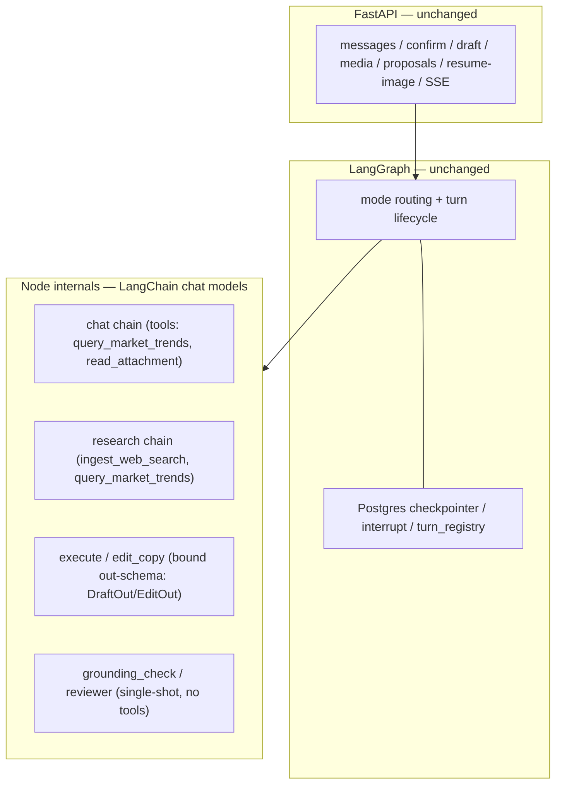

# ADR 0060 — LangChain inner harness; supersedes the Pydantic AI loop

- **Status:** Accepted
- **Date:** 2026-11-19
- **Supersedes:** [ADR 0019](./0019-pydantic-ai-inner-harness.md)
- **Related:** [ADR 0002](./0002-rest-source-of-truth-sse-enhancement.md) (REST SSOT + SSE dedupe unchanged); [ADR 0003](./0003-confirm-without-llm.md) (Confirm stays HTTP, never a tool); [ADR 0004](./0004-stop-discard-and-image-resume.md) (Stop → abort semantics unchanged); [ADR 0011](./0011-knowledge-commit-without-llm.md) (catalog upsert stays HTTP, never a tool); [ADR 0021](./0021-org-byok-native-gemini.md) (Vertex Express is api_key-only, no ADC); [ADR 0047](./0047-session-file-attachments.md) (`read_attachment` contract + budget)

## Context

[ADR 0019](./0019-pydantic-ai-inner-harness.md) narrowed LangGraph to mode routing + turn lifecycle and bought the inner agent loop from Pydantic AI: three narrow agents (`chat`, `query_generator`, `executor_post`/`edit_copy`) plus hand-rolled `complete_json`/`complete_text` single-shots on litellm for the remaining nodes. That split paid: tool loops, typed outputs, and `TestModel`-driven CI.

What did not pay:

- **Two agent stacks in one process.** LangGraph owns the outer loop; Pydantic AI owns the inner. Every cross-layer concern — BYOK model resolution, streaming deltas, cancellation, `recorder.track` correlation, provider-error wrapping — is implemented and tested twice, on two different API surfaces.
- **The lock-in surface grew past `tool signature + output_type`.** `TestModel`, `RunContext[Deps]`, `set_*_model_override` hooks, and `live_harness_model`'s provider mapping are all Pydantic-AI-shaped. Any framework change costs the harness *and* its test idiom.
- **The hand-rolled streaming path duplicates what a chat-model layer gives for free.** `internal/llm/router.py` re-implements streaming JSON, usage capture, first-token timing, and provider kwargs per provider type — the exact surface LangChain's `BaseChatModel.astream` standardises.
- **LangChain's 0019-era objection no longer applies to the layer we now want.** 0019 rejected `create_agent` because a nested graph inside our graph makes state ownership ambiguous. That rejection stands for graph semantics — and we are not adopting it. What we adopt is `langchain-core`'s chat-model + tool-calling layer (`bind_tools`, `astream`, structured output via a bound out-schema): no nested graph, no second state machine, `SessionState` ownership unchanged.

Constraints that must not move are restated verbatim from 0019 because this migration changes the *vendor of the inner loop*, not the boundaries around it:

- Confirm / `publish_social_post` / org catalog upsert stay traditional HTTP — never harness tools ([ADR 0003](./0003-confirm-without-llm.md), [ADR 0011](./0011-knowledge-commit-without-llm.md)).
- Knowledge stays PostgreSQL only; no parallel store.
- Stop must abort in-flight work; REST stays the source of truth, SSE an enhancement layer ([ADR 0002](./0002-rest-source-of-truth-sse-enhancement.md)).
- CI gates mock the LLM; no live key required ([docs/TESTING.md](../TESTING.md)).

## Decision

### 1. Layers — same shape, different vendor

- **FastAPI: unchanged.** All HTTP boundaries stay.
- **LangGraph: unchanged.** `graph.py`, `service.py`, `turn_registry`, checkpointer, `interrupt_before` — none of this moves.
- **LangChain `langchain-core` chat models: the inner loop.** Per-stage narrow chains register only that stage's tools (allowlist stays "the tool does not exist"). Typed outputs ride the tool loop as a **bound out-schema** — `bind_tools([*tools, OutT])`, the same mechanism `with_structured_output` uses internally — over the `internal/session/io.py` Pydantic models (`DraftOut`/`EditOut`/`QueryGenOut`), preserving the structured-I/O contract. A tool loop, where a node needs one, is a small in-node `bind_tools` + tool-execution cycle — **not** `create_agent`, `ToolNode`, or a nested `StateGraph`. Graph semantics stay single-level.
- **`grounding_check` / `reviewer` stay single-shot** — an agent loop there only adds variance and cost (unchanged from 0019).

### 2. The seams keep their signatures

The migration is invisible to the graph and to most tests because the seams do not change shape:

- `internal/llm/router.py` keeps `complete_json(*, tier, system, user, temperature) -> str` and `complete_text(...) -> str`, now implemented on LangChain chat models instead of the hand-rolled litellm streaming path. Return type stays `str` — callers keep `json.loads`/`model_validate` and ~115 unit-test patch sites (`N.complete_json`, `N.complete_text` in `test_session_nodes.py`, `test_session_thread_recap.py`, `test_question_graph_nodes.py`) pass unmodified.
- The three harnesses keep their runner signatures — `stream_chat_reply`, `run_query_generator_agent`, `run_executor_post_agent`, `run_edit_copy_agent` — and keep a model-override test hook (LangChain `BaseChatModel` injected in place of the resolved live model; `GenericFakeChatModel`/`FakeMessagesListChatModel` replace `TestModel`).
- Node functions keep `(SessionState) -> dict` shape and `@agent_progress`/`call_context` wrapping. The graph compiles identically.

### 3. Behavioural parity requirements

- **Streaming:** `astream` deltas fan out to `message.delta` with the same 24-char flush; final text lands on the same state keys.
- **Cancel:** task cancellation propagates through `astream` and closes the provider connection (best-effort upstream abort, same as ADR 0004 semantics); partial text is stashed on the record before re-raise — no `RunCancelled`-style wrapper needed if cancel surfaces as `CancelledError`; if a provider raises a framework cancellation type it is mapped to `CancelledError` at the seam.
- **Recording:** `recorder.track` still wraps each call at the same points — `kind`, `tier`, `mark_first_token`, `set_usage`, `response_text` shapes unchanged so `llm_call_records`, Session Trace, and `eval_cost_from_records` keep working.
- **Tools:** `query_market_trends`, `read_attachment`, `ingest_web_search` port to `@tool` with identical names/schemas and identical refusal contracts (`schemas/tools.py`). `read_attachment` keeps the 3-read/turn budget and per-call owner re-scope ([ADR 0047](./0047-session-file-attachments.md) §6/§14); the per-turn counter travels via an `InjectedToolArg` parameter the tool loop fills from a per-turn deps dataclass — an inner-fn seam, not a framework-owned deps object (no `RunContext[Deps]` analogue).
- **BYOK:** `resolve_llm_model(tier)` stays the resolution choke point; provider mapping per `provider_type` — `ChatOpenAI` with `base_url` for `openai_compatible`/OpenRouter (slug stripping preserved), `ChatAnthropic` for Anthropic, Google per §4.

### 4. Vertex Express is the known unknown

[ADR 0021](./0021-org-byok-native-gemini.md) locks Vertex Express to **api_key-only — no ADC**. `langchain-google-vertexai` assumes ADC; `langchain-google-genai` (AI Studio key) may fit Express keys. Spike order: `langchain-google-genai` → keep the existing hand-rolled `_vertex_*` path behind the same `complete_json` seam if neither package honours key-only auth. The seam makes either outcome transparent; record the result in this ADR's follow-up note or STATUS.

**Resolved (landed):** `ChatGoogleGenerativeAI(vertexai=True, google_api_key=…)` constructs the genai SDK client in Vertex Express mode (`client.vertexai === true`, verified offline) — the harness path uses it, no `langchain-google-vertexai` needed. The `complete_json`/`complete_text`/`astream_text` seams keep the existing hand-rolled `express_client` path for `vertex_ai` unchanged.

### 5. Migration order

Working checklist lived in `docs/LANGCHAIN_MIGRATION.md` (temporary; deleted when the migration landed). Order: this ADR → deps (`langchain-core` + provider packages, versions ≥7 days old) → `complete_json`/`complete_text` on LangChain → three harnesses (chat, research, execute) → re-point `scripts/eval_agent.py` → rewrite the five Pydantic-AI-coupled test files at the same abstraction level → `pydantic-ai-slim` removed last.

**Coverage never shrank mid-migration.** During the port each provider kept its current path behind the same seam until a verified LangChain replacement landed. Final state: `router.lc_harness_model` is the single provider map — `anthropic` + the `claude`-by-name heuristic → `ChatAnthropic` (`langchain-anthropic`), `gemini`/`vertex_ai` → `ChatGoogleGenerativeAI` (`langchain-google-genai`, `vertexai=True` for Express), openai/openai_compatible → `ChatOpenAI`; a missing package raises `LlmProviderError(kind=unsupported)` exactly like the old extras check. `pydantic-ai-slim` is removed; `google-genai` is now an explicit dep because `vertex_express.py` uses the SDK directly. The `complete_json`/`complete_text`/`astream_text` fallbacks for anthropic/gemini stay on litellm and the vertex express path — unchanged and independent of pydantic.

Regression anchor: `scripts/eval_agent --suite regression --out reports/eval/baseline.json` on main before the swap, `scripts/eval_diff` after — set-coverage metrics must not regress (`--strict-models` if the resolved model set changes).

Rejected, restated: a nested LangGraph/`create_agent` inner loop (state ownership ambiguity — the original 0019 objection); OpenAI/Claude Agent SDK and other second control planes (unchanged from 0019); exposing `schemas/` through a TypeScript-first framework (unchanged).

## Consequences

- `pydantic-ai-slim` is removed (done — all three harnesses, the eval voice judge, and all tests run on `BaseChatModel`); `litellm` stays for the pricing cost map, the `complete_*` anthropic/gemini fallback, and the image path.
- One agent stack: model resolution, streaming, cancel, and recording converge on `BaseChatModel`; new providers are a `provider_type` mapping entry, not a new adapter surface.
- The five harness-own test files (`test_session_harness.py`, `test_session_research_harness.py`, `test_session_execute_harness.py`, `test_read_attachment_tool.py`, `test_session_chat_attachments.py`) are rewritten against `langchain_core.language_models.fake_chat_models`; every other unit/API/eval test must pass **unmodified** — a patch-site failure means the seam moved, which is a bug in the migration, not the test.
- Explicitly out of scope, unchanged from 0019: checkpointer changes; an MCP-server control plane; publish-class tools; a document RAG store; in-loop tool approval (future need → park → HTTP → resume per 0019 §3).
- `ROADMAP` and per-node prompt internals may tune without a superseding ADR; changing the layer boundaries, the no-publish-tool rule, the approval shape, or the seam signatures requires one.
